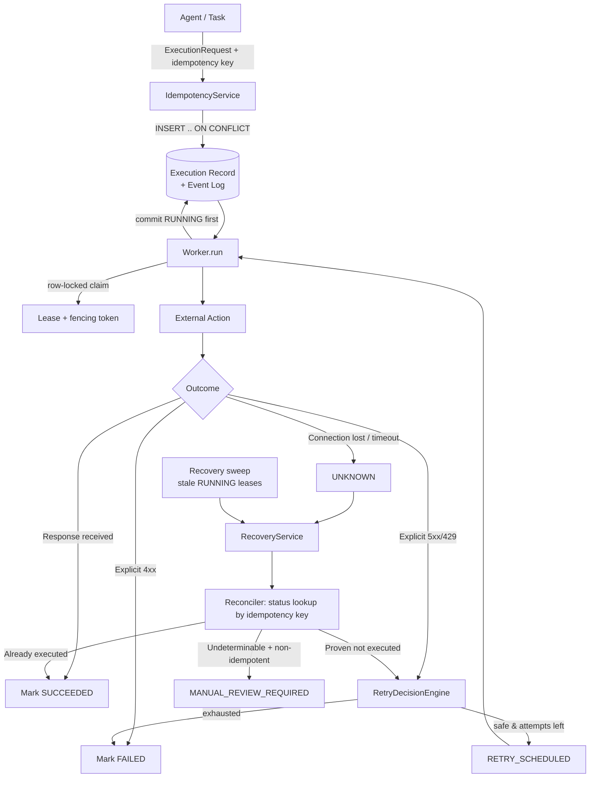

# Durable Agent/Tool Execution — Reference Implementation

A small, fully runnable Python reference showing how an AI-agent runtime can
execute **external actions** (API calls with real-world side effects) reliably
when workers crash, networks drop responses and multiple workers compete.

It covers durable execution records, database-backed worker leases with fencing
tokens, idempotency keys, bounded retries, reconciliation of uncertain outcomes,
crash recovery, tenant/workspace isolation, structured logging and
deterministic failure injection, all backed by a real PostgreSQL test suite.

> **Sanitized walkthrough.** Every name, action type, payload and credential
> here is synthetic. The code contains no client code, schemas, URLs or secrets.
> The "external system" is an in-process fake with its own state.

---

## 1. Purpose

The hard part of agent tool execution is not calling the tool. It is answering
this question correctly after something goes wrong:

> *Did the action actually happen, and is it safe to do it again?*

This repository shows a production-style answer: **PostgreSQL is the source of
truth, worker memory never is**. Uncertainty gets resolved by **asking the
external system** (reconciliation). The worker never assumes an answer.

## 2. Architecture



| Module | Responsibility |
|---|---|
| `models/enums.py` | State machine, transition table, event and error vocabularies |
| `models/execution.py` | `ExecutionRecord` (current state) and `ExecutionEvent` (append-only history) |
| `database/repository.py` | **All** state changes: row-locked, validated, fenced, with events in the same transaction |
| `execution/lease.py` | Lease acquire / renew / release / heartbeat |
| `execution/idempotency.py` | Key registration, fingerprinting, conflict detection |
| `execution/executor.py` | One external call → classified outcome (no DB access) |
| `execution/retry.py` | `RetryPolicy` and the pure `RetryDecisionEngine` |
| `execution/recovery.py` | Takeover of uncertain/stale executions → reconcile → decide |
| `execution/worker.py` | Routes one execution by durable status; one step per run |
| `external/fake_service.py` | Fake third-party API with its own state and failure injection |
| `external/client.py` | Action registry (safety properties) + error translation |
| `external/reconciliation.py` | Read-only "what actually happened?" |
| `security/context.py` | `ExecutionContext` (workspace/task/agent), redaction |
| `logging/setup.py` | Structured, redacted, context-carrying logs |

## 3. State machine

```text
PENDING ──► CLAIMED ──► RUNNING ──┬──► SUCCEEDED
   ▲          │  ▲               ├──► FAILED
   └──────────┘  │               ├──► RETRY_SCHEDULED ──► CLAIMED
   (release)     │               ├──► UNKNOWN ──► RECONCILING
                 │               └──► RECONCILING   (stale RUNNING recovered)
     reclaim when lease expired
     (no call can have started)

RECONCILING ──┬──► SUCCEEDED               external system confirms success
              ├──► FAILED                  confirmed rejected, or confirmed absent + no attempts left
              ├──► RETRY_SCHEDULED         only when a repeat is provably safe
              ├──► UNKNOWN                 status lookup temporarily unavailable
              ├──► RECONCILING             dead reconciler taken over
              └──► MANUAL_REVIEW_REQUIRED  outcome cannot be safely determined

MANUAL_REVIEW_REQUIRED ──► SUCCEEDED | FAILED | CANCELLED   (operator decision)
```

* `SUCCEEDED`, `FAILED` and `CANCELLED` are terminal. `MANUAL_REVIEW_REQUIRED`
  is terminal for automation.
* The table lives in `ALLOWED_TRANSITIONS` and every write goes through
  `validate_transition()` while holding the row lock.
* **There is no `RUNNING → PENDING` and no `UNKNOWN → CLAIMED` edge.** Once a
  call may have started, the only path back to execution goes through
  `RECONCILING`.

## 4. The failure scenario

```text
1. Worker A claims execution, gets lease (token T1)       CLAIMED
2. Worker A commits RUNNING + EXTERNAL_CALL_STARTED       RUNNING   ← write-ahead intent
3. External system performs the action and commits it    (side effect exists)
4. Connection drops before the response arrives
5. Worker A records UNKNOWN (not FAILED) and exits        UNKNOWN
6. Worker B starts, loads the execution from PostgreSQL
7. Worker B sees UNKNOWN → takes recovery lease (T2)      RECONCILING
8. Worker B asks the external system by idempotency key → "SUCCEEDED, ext-000001"
9. Worker B records SUCCEEDED with the existing result    SUCCEEDED
10. External side effects: 1
```

If Worker A died silently instead of writing `UNKNOWN` (step 5), the record
stays `RUNNING` with lease T1. Once T1 expires, the recovery sweep finds it and
follows the same path from step 7. That case is covered by
`test_worker_dies_lease_expires_second_worker_recovers`.

## Why the Worker Does Not Blindly Retry

```text
A successful external side effect and a successful network response
are two different events.

The worker can lose the response after the external system has already
committed the action.

Therefore UNKNOWN does not mean FAILED.

The recovery path first attempts to determine the external state.
Only after reconciliation can the system safely decide whether to
return the existing result, retry, or require manual intervention.
```

### Delivery semantics, stated precisely

| Semantics | How you get it | Risk |
|---|---|---|
| **At-most-once** | Never retry after an uncertain outcome | Silently lost actions |
| **At-least-once** | Always retry after an uncertain outcome | Duplicate side effects (double charge, double shipment) |
| **Effectively-once** | At-least-once delivery **+** idempotency key honoured by the external system **+** reconciliation before retry | Needs external cooperation. When that is missing, the honest answer is `MANUAL_REVIEW_REQUIRED` |

This repository does **not** claim exactly-once execution. An idempotency key
on our side guarantees one *logical execution record*. Avoiding a second
*external effect* depends on the external system: either it deduplicates by
key, or its status lookup can prove the action did not happen. The action
registry records which guarantee each action type has:

| Action type | Idempotent by key | Authoritative lookup | Uncertain outcome + "not found" ⇒ |
|---|---|---|---|
| `create_invoice` | yes | yes | safe retry (external dedupes anyway) |
| `send_notification` | no | yes | safe retry (absence is proven) |
| `send_physical_order` | no | no | **manual review**. Absence is not proof. |

## 5. Idempotency

* Keys are scoped per workspace: `UNIQUE (workspace_id, idempotency_key)`.
* Registration uses `INSERT ... ON CONFLICT DO NOTHING`. When N concurrent
  submissions race, exactly one creates the record and the rest receive it.
  There is no check-then-insert race.
* Each record stores a SHA-256 **fingerprint** of the canonical
  `(action_type, payload)`. Reusing a key with a different amount, customer,
  parameters or action type raises `IdempotencyConflictError`. It never
  silently returns the old result.
* A duplicate submission returns the existing execution, including its stored
  result if it already succeeded, and schedules no new work.
* Payloads containing credential-like keys (`api_key`, `token`, `password`, …)
  are refused, so secrets can never be persisted in an execution.

## 6. Lease

An `asyncio.Lock` only protects one process. Leases live **in the execution
row**, so PostgreSQL arbitrates between every worker on every host.

* **Owner + unique token + expiry** (expiry uses database time via
  `clock_timestamp()`, so worker clock skew does not matter).
* **Acquire** runs `SELECT … FOR UPDATE`, checks the conditions, then updates,
  all in one short transaction. Two simultaneous claimants serialise on the row
  lock and the second sees a live lease.
* **Fencing token.** Every takeover issues a new token, and every write must
  present the current token. A worker that paused past its expiry (GC pause,
  network stall) and then tries to write `SUCCEEDED` gets `StaleLeaseError`.
  It cannot overwrite the new owner (see `test_slow_worker_is_fenced_after_lease_takeover`).
* `mark_running` additionally requires the lease to be *unexpired*, so a
  side effect is never started on a lease that might already belong to someone else.
* **Renew** and **release** verify the token. A `RUNNING` lease cannot be
  released at all, because the worker must record an outcome and keep the
  uncertainty visible.
* A heartbeat (`LeaseManager.keep_alive`) renews long-running calls.
* External calls are **never** made while holding a DB transaction or row lock.

## 7. Retry policy

`RetryPolicy(max_attempts=3, initial_delay=1, max_delay=30, backoff_multiplier=2, jitter=0)`
gives delays of 1s → 2s → 4s, capped at `max_delay`. Jitter only shortens a
delay, so `max_delay` stays a hard bound. `RetryDecisionEngine.should_retry()`
is a pure function and is unit-tested rule by rule:

| Situation | Retry? | Why |
|---|---|---|
| Explicit 5xx / 429 (`TRANSIENT`) | yes, with backoff until `max_attempts` | the external system said it did not apply the action |
| Validation (400/422) | **no** | the same request will fail the same way |
| Authentication (401/403) | **no** | retrying cannot fix credentials |
| Other permanent 4xx | **no** | explicit permanent rejection |
| Idempotency conflict | **no** | caller bug; must be surfaced |
| Lease not held | **no** | only the current owner may decide |
| Outcome unknown, not yet reconciled | **no, reconcile first** | the side effect may exist |
| Unknown → reconciled: executed | **no** | record the existing result |
| Unknown → reconciled: proven not executed | yes (within budget) | provably safe |
| Unknown → inconclusive, idempotent action | yes (within budget) | external system deduplicates by key |
| Unknown → inconclusive, non-idempotent | **no → manual review** | a retry could duplicate the side effect |

Retries are not loops inside the worker. Each one is a durable
`RETRY_SCHEDULED` state with `next_attempt_at`, and any worker can pick it up.

## 8. Recovery

`RecoveryService.recover_stale_executions()` is a sweep any worker can run. It
finds `UNKNOWN` executions and `RUNNING`/`RECONCILING` executions whose lease
has expired. For each one it:

1. **verifies the old lease is actually expired** under a row lock (the
   candidate query is only a hint), then takes a recovery lease with a new token;
2. **blocks concurrent recovery**: five simultaneous recoverers produce one
   reconciliation and four `SKIPPED_LEASE_HELD` (tested);
3. **assumes a side effect may exist** because the record is `RUNNING`;
4. **reconciles** with a read-only status lookup;
5. **retries only when safe**, per the retry engine;
6. **preserves history**. A `RECOVERED` event records the previous owner,
   status and lease expiry. Nothing is overwritten or deleted.

A `CLAIMED` execution whose worker died is different: `RUNNING` was never
committed, so no call can have started, and the next claimant can safely re-claim it.

## 9. Tenant isolation

* `ExecutionContext(workspace_id, task_id, agent_id)` is frozen and recorded
  on every execution.
* Every repository method that touches one execution requires `workspace_id`
  and puts it in the SQL `WHERE` clause. A record from another workspace shows
  up as *not found*, so tenants cannot even learn that it exists.
* Idempotency keys are unique per workspace, so tenants cannot collide or probe
  each other's keys.
* `Worker.run` also rejects a context whose task/agent does not match the record.
* The only cross-tenant query is the recovery sweep's candidate scan, which
  returns identifiers only. Everything after it goes back through
  workspace-scoped methods.
* The context is bound to a `ContextVar`, so every log line carries
  `workspace_id/task_id/agent_id`. Credential-like keys are redacted before
  anything is logged or stored.

## 10. Test strategy

65 tests run against **real PostgreSQL**, because row locks, unique constraints
and DB time are exactly what is under test. Each simulated worker has **its own
engine and connection pool**, which mirrors separate processes. Failures are
injected deterministically (FIFO script), crashes are simulated with a
`BaseException` that no `except Exception` can swallow, and lease expiry is
forced via SQL instead of `sleep`.

| # | Requirement | Test |
|---|---|---|
| 1 | Normal success `PENDING → RUNNING → SUCCEEDED` | `test_worker_execution::test_normal_success_pending_running_succeeded` |
| 2 | Transient failure → retry → success | `test_retry::test_transient_failure_then_success` |
| 3 | Max retries → FAILED | `test_retry::test_max_retries_exhausted_marks_failed` |
| 4 | Duplicate request → one external operation | `test_idempotency::test_duplicate_request_produces_one_external_operation` |
| 5 | Same key, different payload → rejected | `test_idempotency::test_same_key_with_different_request_is_rejected` (amount / customer / action) |
| 6 | Lease prevents two workers | `test_concurrent_workers::test_two_workers_race_only_one_executes`, `…many_workers…` |
| 7 | Worker dies, lease expires, B recovers | `test_recovery::test_worker_dies_lease_expires_second_worker_recovers` |
| 8 | **External success + lost response → reconciled, exactly one side effect** | `test_reconciliation::test_external_success_with_lost_response_is_reconciled_exactly_once` |
| 9 | Non-idempotent uncertain op not blindly retried | `test_reconciliation::test_non_idempotent_*` (executed → success; undeterminable → manual review; proven absent → safe retry) |
| 10 | Tenant isolation | `test_tenant_isolation::*` |
| 11 | Lease renewal by owner only | `test_lease::test_lease_renewal_only_by_valid_owner`, `…fails_after_takeover` |
| 12 | Stale owner cannot overwrite new owner | `test_lease::test_stale_owner_cannot_overwrite_new_owner`, `test_concurrent_workers::test_slow_worker_is_fenced_after_lease_takeover` |

Also covered: concurrent same-key submissions, concurrent recoverers, dead
reconciler takeover, crash *before* the call, idempotent re-send deduplicated
externally, bounded reconciliation under lookup outage, backoff/jitter math,
every retry rule, redaction of logs and payloads, and a control experiment
showing that a naive retry would ship a physical order twice.

The suite was also mutation-checked. Weakening the lease check in
`claim_execution` makes the race tests fail.

## 11. Running locally

Prerequisites: Python 3.12+, Docker with the Compose plugin.

```bash
docker compose up -d --wait
```

```bash
python3 -m venv .venv
```

```bash
source .venv/bin/activate
```

```bash
pip install -e ".[dev]"
```

```bash
pytest -q
```

```bash
python examples/failure_recovery_demo.py
```

Quality gates:

```bash
ruff check .
```

```bash
ruff format --check .
```

```bash
mypy
```

Or use the Makefile: `make db-up install check`. To stop the database, run
`docker compose down`. To wipe its data, run `docker compose down -v`.

PostgreSQL listens on **localhost:54329**, which avoids clashing with a local
5432. The demo uses database `durable_demo` and the tests use `durable_test`;
both are created by `docker/postgres/init`. Override them with `DATABASE_URL` /
`TEST_DATABASE_URL` (see `.env.example`).

### Demo output (abridged)

```text
[Worker A] claimed execution
[Worker A] lease acquired
[Worker A] starting external action
[External] action performed successfully
[Network] response lost
[Worker A] execution outcome = UNKNOWN

--- worker restart ---

[Worker B] found existing execution (status=UNKNOWN)
[Worker B] lease acquired
[Worker B] outcome is uncertain
[Worker B] reconciling external state
[Worker B] external state = SUCCESS
[Worker B] marking execution SUCCESS
[Worker B] no duplicate external action created

External side effects: 1
Final execution status: SUCCEEDED
```

Scenario 2 then shows a non-idempotent `send_physical_order` whose outcome
cannot be determined. It ends in `MANUAL_REVIEW_REQUIRED` after exactly one
external call. Run with `--verbose` to see the structured logs.

See [IMPLEMENTATION_NOTES.md](IMPLEMENTATION_NOTES.md) for design decisions and trade-offs.
